# Cloud Lab 1 Submission — Amazon EC2

- **Student name: Im Chheangngim**
- **Student ID: e20221459**
- **Learner Lab user name: voclabs/user5619309=IM_CHHEANGNGIM**
- **Date completed: 23/10/2026**

---

## Part 1.1 — An Amazon EC2 Walkthrough

### Security group

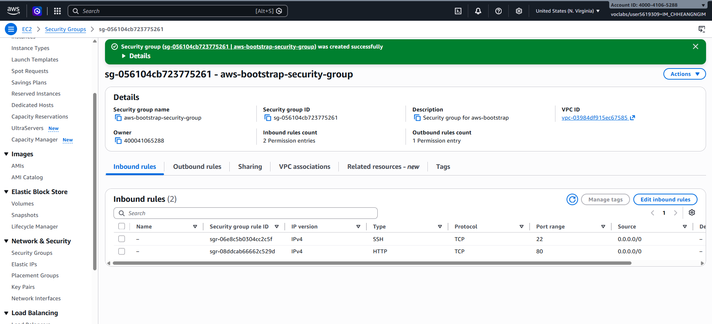

### Key pair

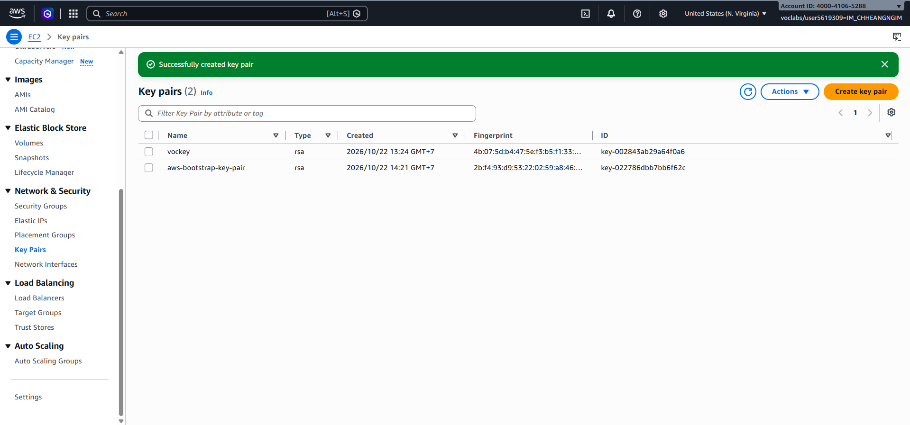

### Instance details

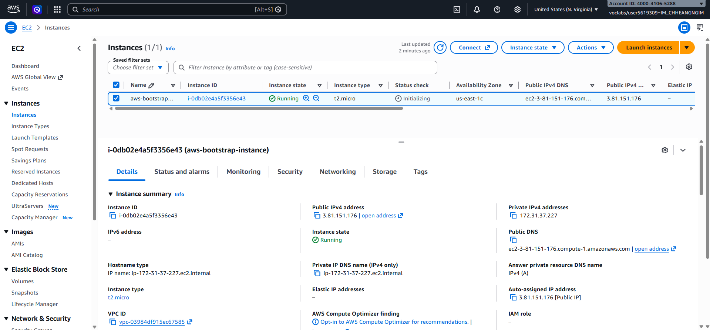

### Browser test

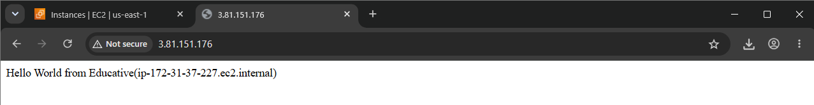

### SSH connection

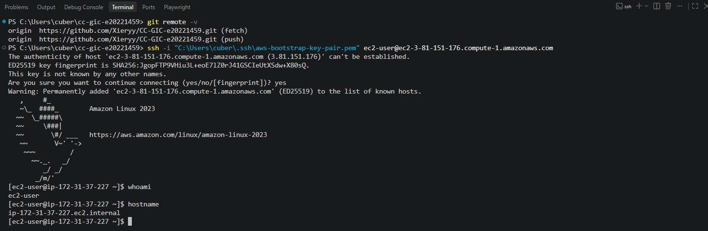

Did you connect with your own SSH client or with EC2 Instance Connect?

I connect with my own SSH client using the private key:
```bash
ssh -i "C:\Users\cuber\.ssh\aws-lab-key-pair.pem" ec2-user@ec2-44-206-231-190.compute-1.amazonaws.com
```

---

## Part 1.2 — EC2 Web Solution (Challenge)

### Launch configuration

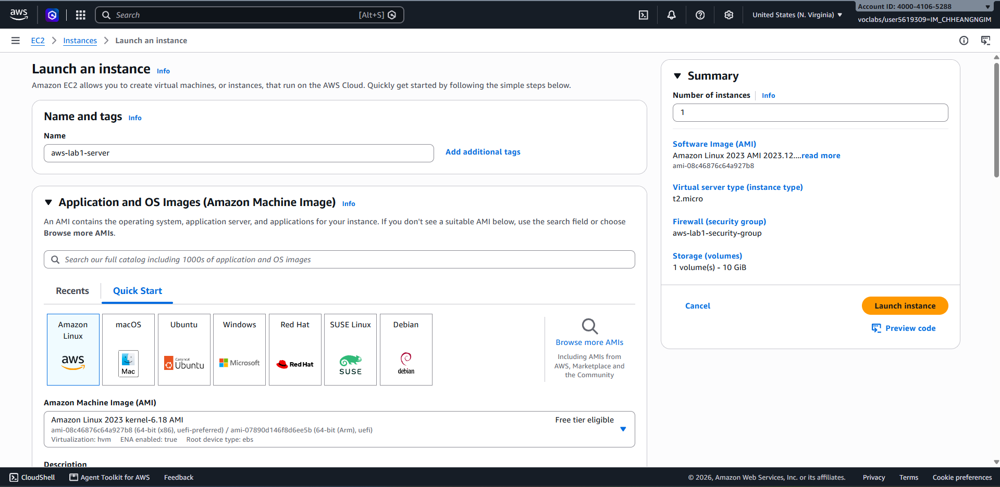

### Security group

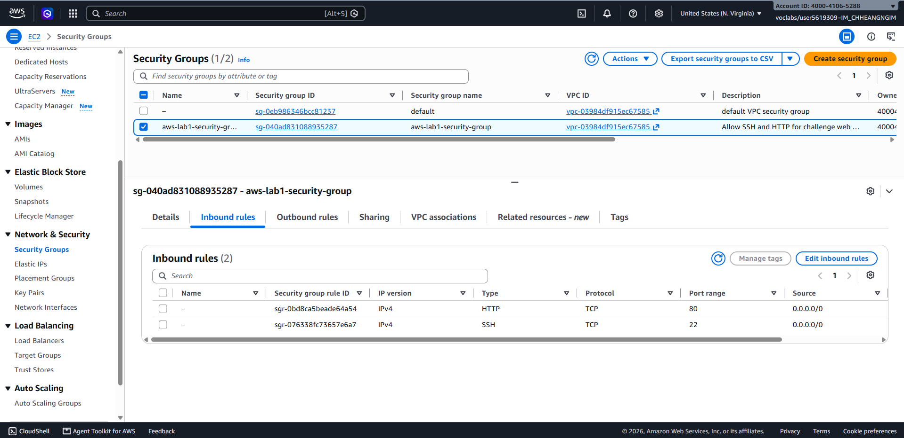

### Running instance

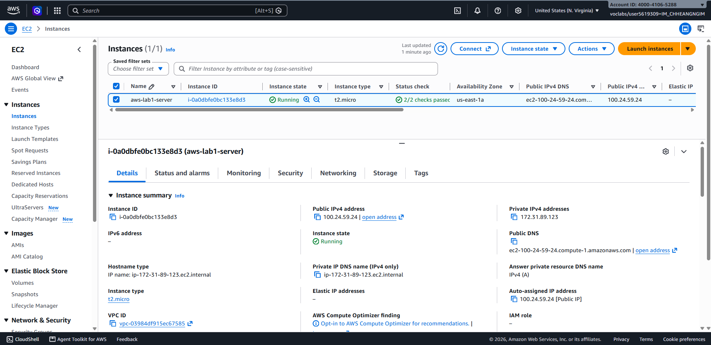

### Commands on the instance

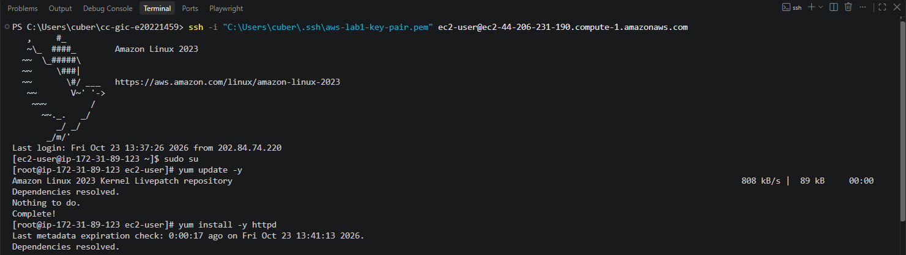
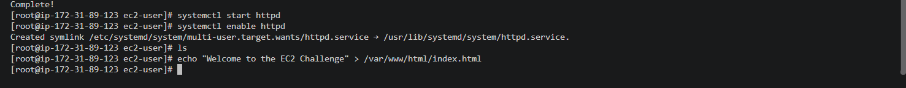

Paste the commands you ran to install the web server and create `index.html`:

```bash
sudo su
yum update -y
yum install -y httpd
systemctl start httpd
systemctl enable httpd
echo "Welcome to the EC2 Challenge" > /var/www/html/index.html
```

### Browser test

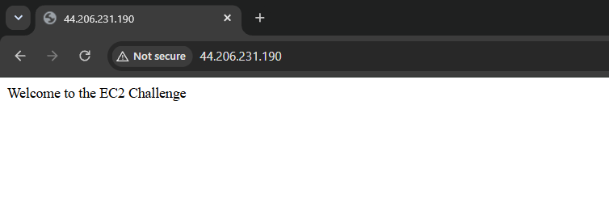

---

## Questions

1. Your security group has an SSH rule and an HTTP rule. What does each one let you do? What would stop working if you deleted the HTTP rule?
   - **SSH rule:** Allows secure remote shell access and terminal administration of the EC2 instance from an SSH client.
   - **HTTP rule:** Allows incoming unencrypted web traffic, enabling web browsers across the internet to access web pages hosted on the instance's web server.
   - **What would stop working if the HTTP rule is deleted:** Incoming requests on port 80 would be blocked and time out, making the website inaccessible in web browsers. SSH access on port 22 would remain unaffected.

2. In Part 1.1 you never logged in to install the web server. What installed it, and when did it run?
   - **What installed it:** The web server was installed by a script provided in the **User Data** field during the EC2 instance launch.
   - **When did it run:** The script was executed automatically by the `cloud-init` service with root permissions once during the very first boot initialization of the instance.

3. Why does the web page open with `http://` but not with `https://`?
   - **Security Group Inbound Rules:** The security group is only configured to allow inbound traffic on port 80 (HTTP). Port 443 (HTTPS) is not open in the security group rules, so HTTPS connection attempts are blocked.
   - **Web Server Configuration:** The Apache web server (`httpd`) is configured only for HTTP over port 80. It does not have an SSL/TLS module installed or configured.

4. Part 1.2 asked for a 10 GiB root volume. Where in the launch settings did you set it, and how can you check the size on the running instance?
   - **Where in launch settings:** In the EC2 Launch Instance under the **Configure storage** section, where the root volume size was modified from the default 8 GiB to **10 GiB**.
   - **How to check on running instance:**
    In EC2 dashboard, go to instance, click on the running instance, then go to **Storage** tab.
    Or connect via SSH and run:
      - `lsblk` — lists block devices and their assigned sizes.
      - `df -h` — displays disk space usage and total capacity of the root file system in human-readable units.

## Problems and how I solved them (optional)

When configuring the Apache server manually in Part 1.2, package management and web root directory modifications required elevated privileges. Used `sudo su` to switch to root before executing `yum` and writing `index.html` to `/var/www/html/`.

## AI note (optional)

## Clean up

- [x] Part 1.1: instance terminated, key pair and security group deleted.
- [x] Part 1.2: instance terminated, security group (and key pair, if any) deleted.
