# Cloud Lab 2 Submission — Load Balancer and Auto Scaling

Copy this template to `cc-lab-YOUR_ID/lab2/README.md` in your own repository. Follow [the instructions](lab2-instruction.md). Put your screenshots in `lab2/images/` with the file names below.

- **Student name: Im Chheangngim**
- **Student ID: e20221459**
- **Learner Lab user name: voclabs/user5619309=IM_CHHEANGNGIM**
- **Date completed: 30/10/2026**

---

## Security groups

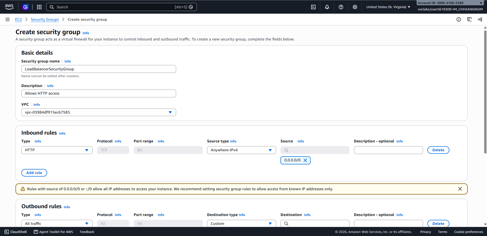

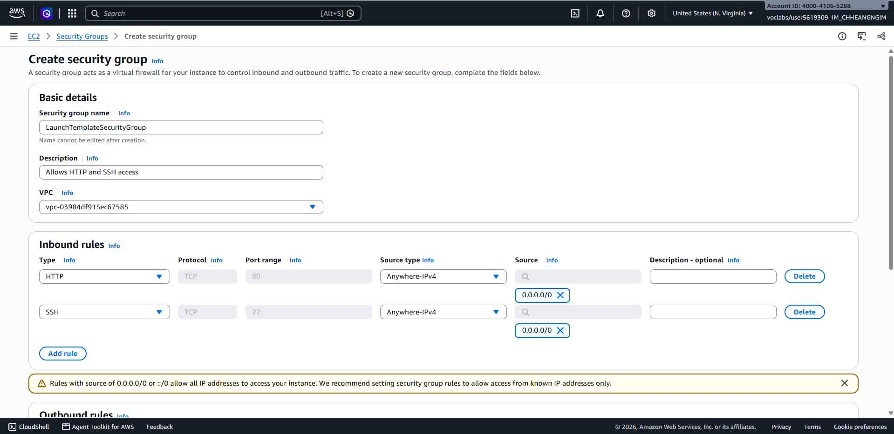

## Target group

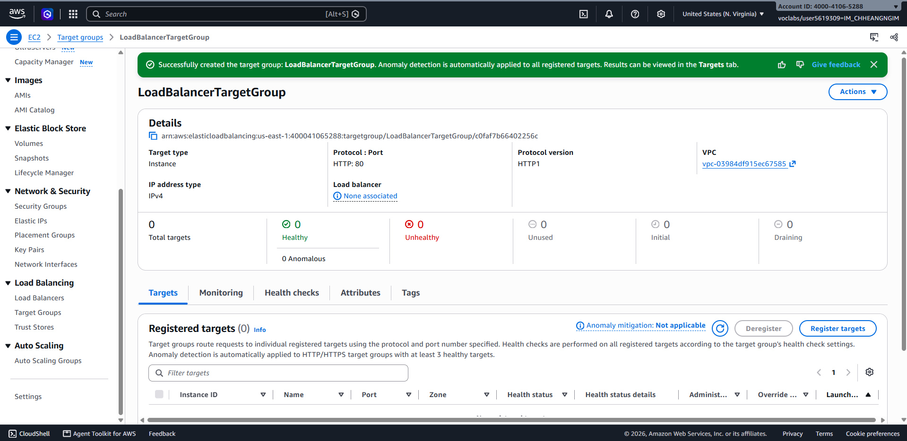

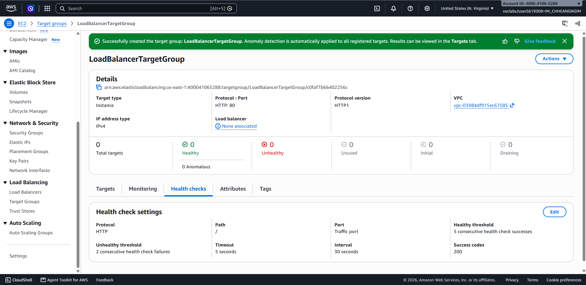

## Application Load Balancer

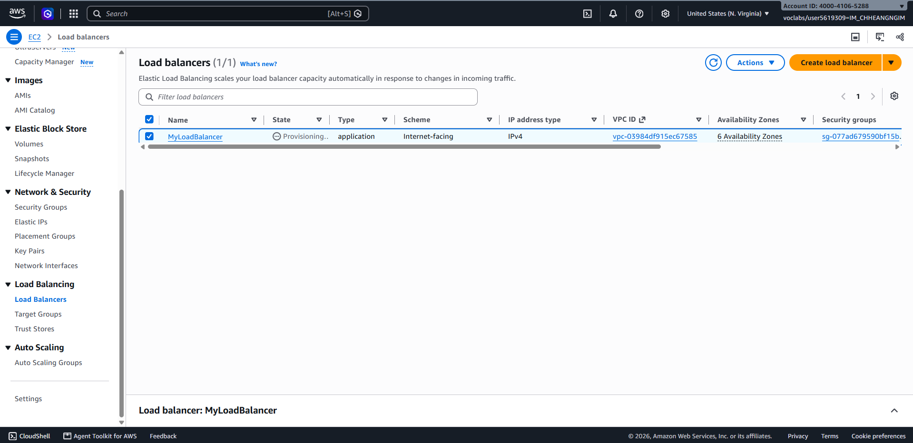

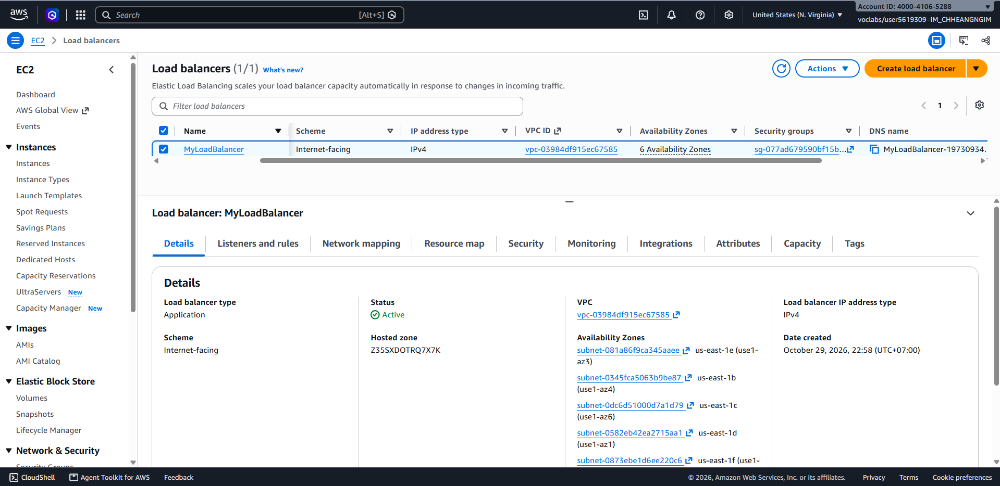

## Launch template

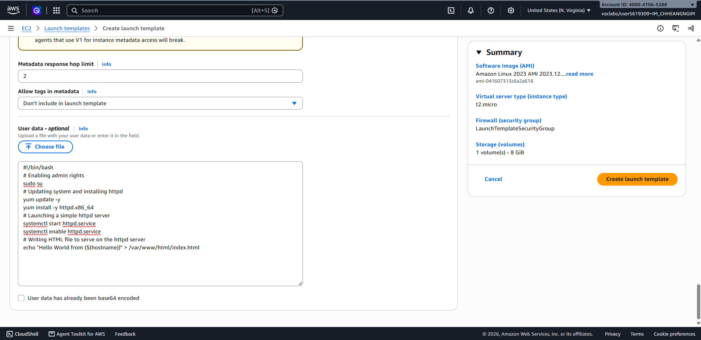

## Auto Scaling group

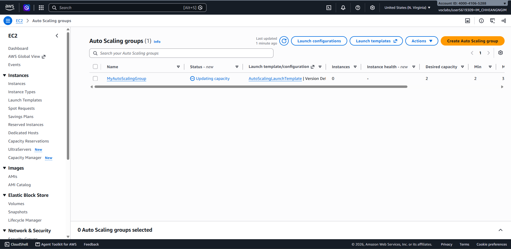

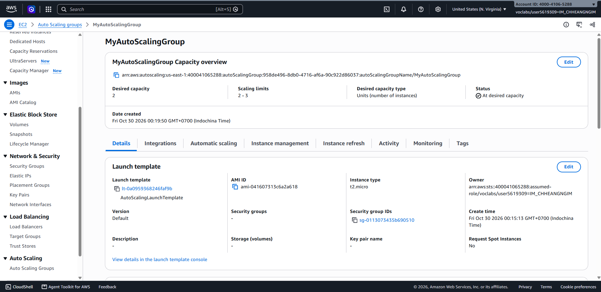

## Load balancing test

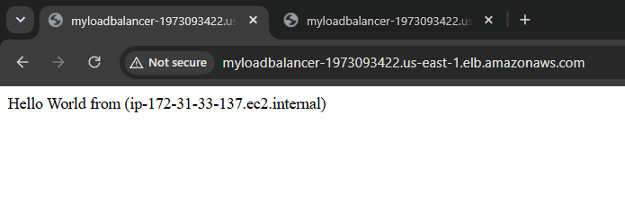

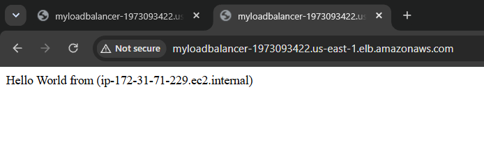

## Simulated application failure

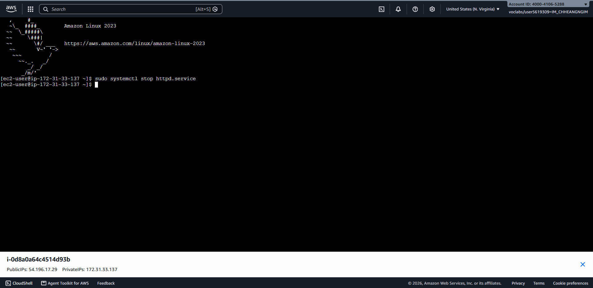

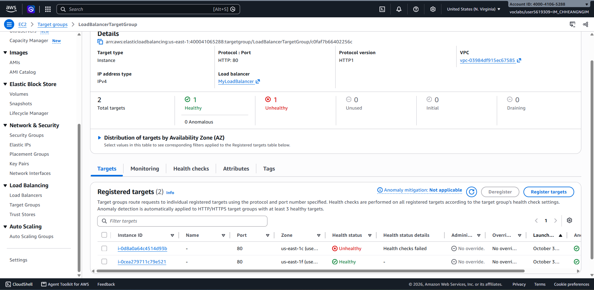

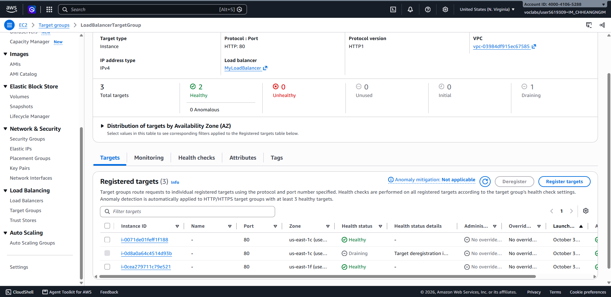

About how many minutes passed between stopping `httpd` and the new instance becoming healthy?

About 3 to 4 minutes passed.

---

## Questions

1. Why does the page show a different host name when you refresh it?
   - The Application Load Balancer distributes incoming HTTP requests across all registered healthy targets in the target group using a round-robin routing algorithm.
   - Because the Auto Scaling group maintains 2 healthy EC2 instances, each configured to output its private hostname, refreshing the browser sends consecutive requests that the load balancer alternates between the two instances (`ip-172-31-33-137` and `ip-172-31-71-229`).

2. After you stopped `httpd`, the instance was still *running* in EC2, but the target group marked it *unhealthy*. What did the health check test, and why did the instance fail it?
   - **What the health check tested:** The target group performs an HTTP GET request on port 80 at path `/` every 30 seconds, expecting an HTTP status code `200 OK` within the 5-second timeout window.
   - **Why it failed:** While the underlying virtual machine (EC2 instance) was still running and passing EC2 hardware/system checks, stopping `httpd.service` terminated the Apache web process. There was no service listening on port 80 to accept TCP connections and return an HTTP `200` response. After 2 consecutive failures, the target group declared the instance `unhealthy`.

3. Who replaced the failed instance: the load balancer, the target group, or the Auto Scaling group? Explain the role of each one.
   - **The Auto Scaling group (ASG)** replaced the failed instance.
   - **Roles of each component:**
     - **Target Group:** Actively probes registered targets via HTTP health checks. When `httpd` stopped, it detected the failure and marked the target as `unhealthy`, reporting this status to the load balancer and ASG.
     - **Load Balancer (ALB):** Stops routing incoming traffic to targets marked `unhealthy` by the target group, preventing end users from receiving HTTP 502/504 errors. It does not create or destroy instances.
     - **Auto Scaling Group (ASG):** Enforces capacity and fleet health. Using ELB health checks, ASG identifies when an instance is reported unhealthy by the target group, terminates the faulty instance, provisions a fresh EC2 instance from the Launch Template, and registers it with the target group to maintain the desired capacity of 2.

4. With desired 2, minimum 2 and maximum 3, how many instances run normally? In what situation could there be 3?
   - **Normally running instances:** **2** instances run normally, matching the Desired Capacity setting.
   - **Situations where there could be 3 instances:**
     1. **Dynamic / Target Tracking Scaling:** If a scaling policy is configured like CPU utilization exceeding 60% or high request count per target, ASG scales out by launching a 3rd instance up to the maximum capacity of 3.
     2. **Manual Scaling Adjustment:** If an administrator increases the Desired Capacity from 2 to 3 in the AWS Management Console or AWS CLI.
     3. **Temporary Surge during Instance Refresh / Replacement:** While an unhealthy or old instance is draining connections and terminating, ASG may temporarily launch the replacement instance, briefly resulting in 3 instances until termination finishes.

5. The instances' security group allows HTTP from anywhere. How could you change it so that the instances accept HTTP **only** from the load balancer?
   - In the EC2 Console under **Security Groups**, select `LaunchTemplateSecurityGroup` and edit its **Inbound rules**.
   - Modify the HTTP rule (port 80):
     - Change the **Source** from `0.0.0.0/0` (Anywhere-IPv4) to **Custom**.
     - Specify the Security Group ID of the Application Load Balancer.
   - Save the rule. This uses security group referencing to ensure the EC2 instances accept HTTP traffic exclusively when forwarded by the ALB, blocking direct public access.

## Problems and how I solved them (optional)

## AI note (optional)

- **AI Suggestion:** Used AI to clarify the division of responsibility between the ALB, Target Group, and Auto Scaling Group during an instance failure.
- **Verification:** Verified by observing the Target Group console status change to `Draining` and `Unhealthy` while the Auto Scaling Group Activity History showed the termination and launch events.

## Clean up

- [x] `MyAutoScalingGroup` deleted and its instances terminated.
- [x] `AutoScalingLaunchTemplate` deleted.
- [x] `MyLoadBalancer` and `LoadBalancerTargetGroup` deleted.
- [x] Both security groups deleted.