# Cloud Lab 4 Submission — Amazon VPC

- **Student name: Im Chheangngim**
- **Student ID: e20221459**
- **Learner Lab user name: voclabs/user5619309=IM_CHHEANGNGIM**
- **Date completed: 12/11/2026**

---

## VPC and internet gateway

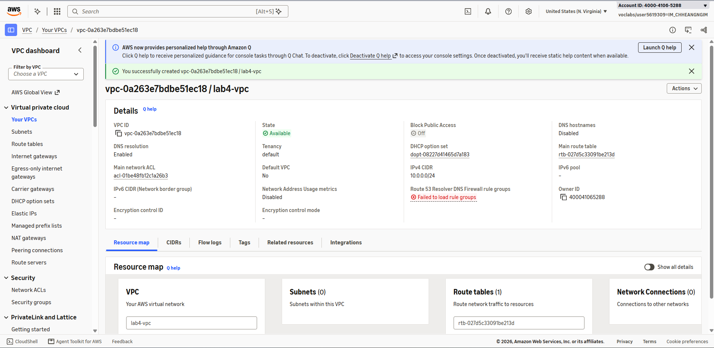

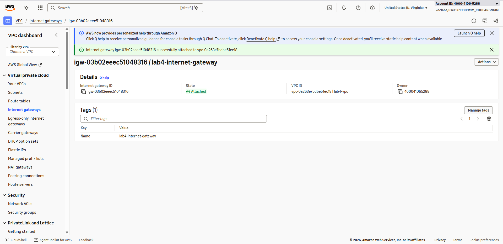

## Public subnet

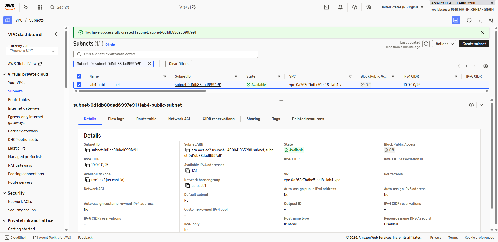

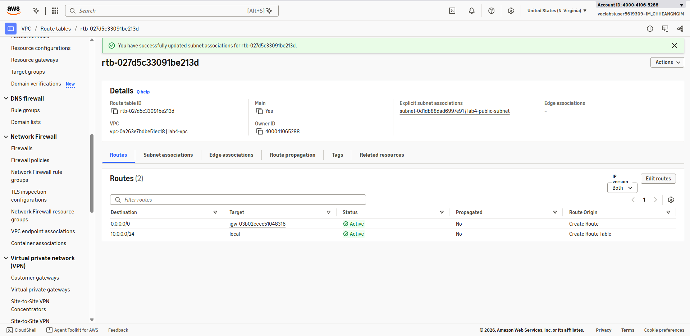

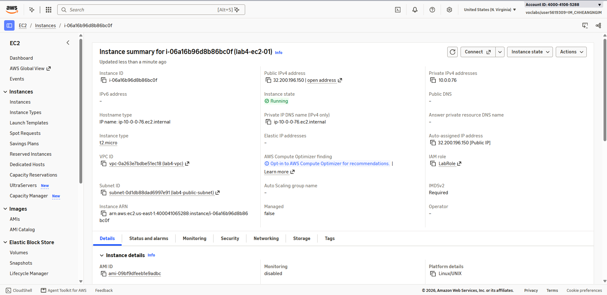

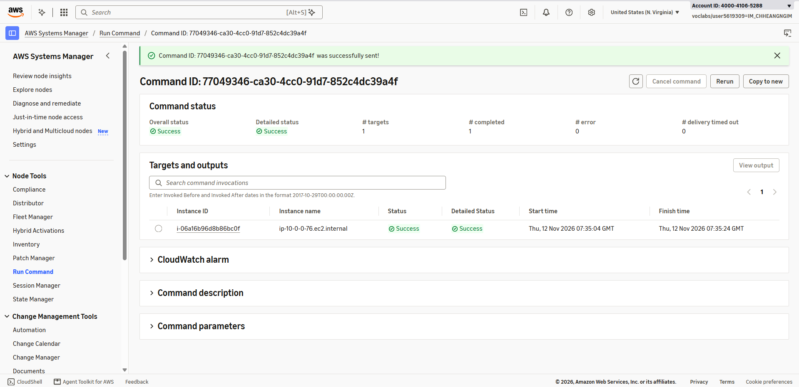

## Private subnet

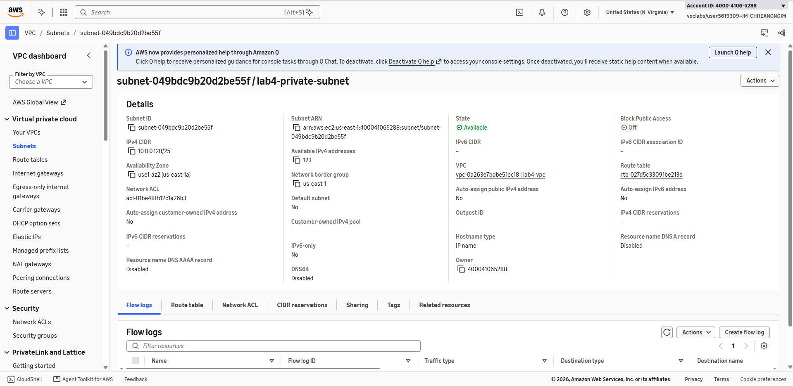

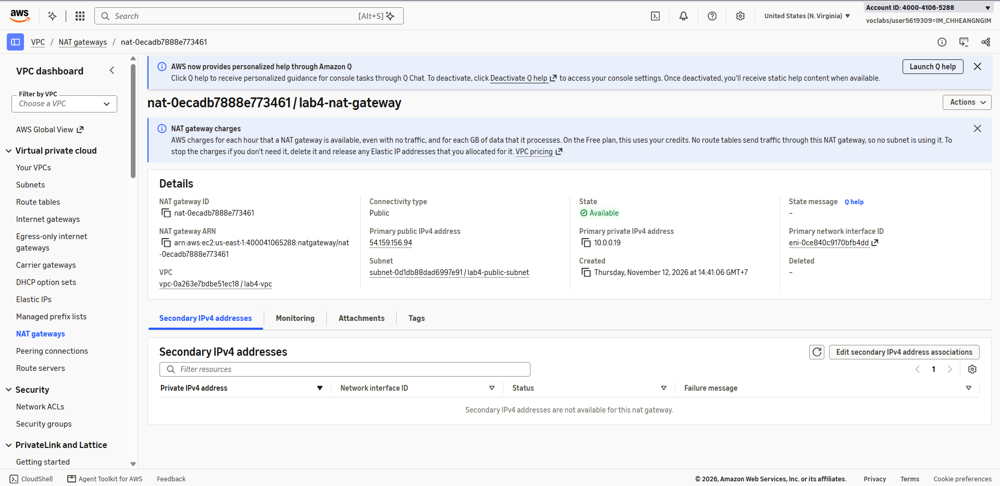

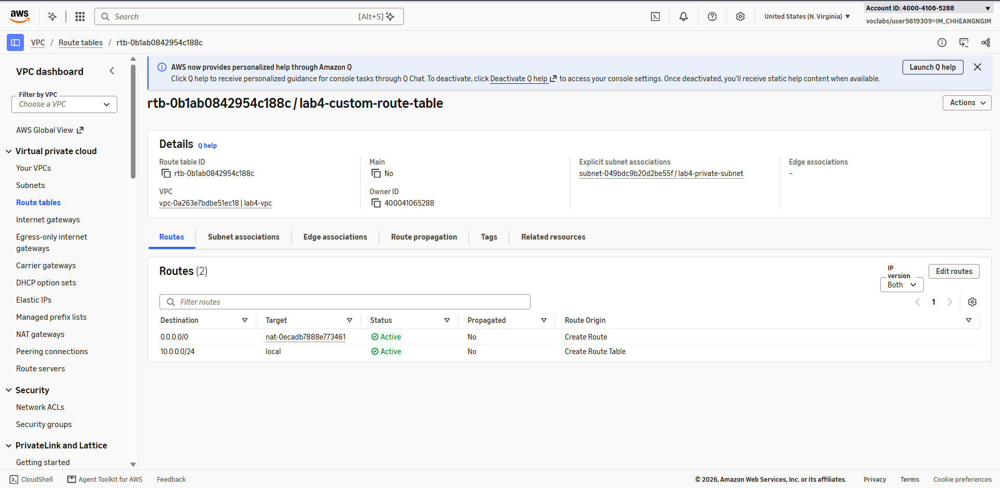

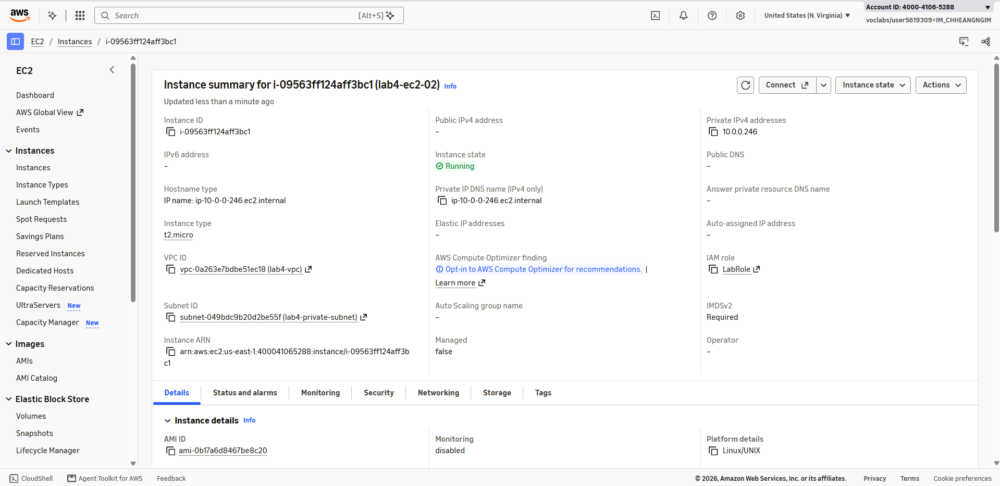

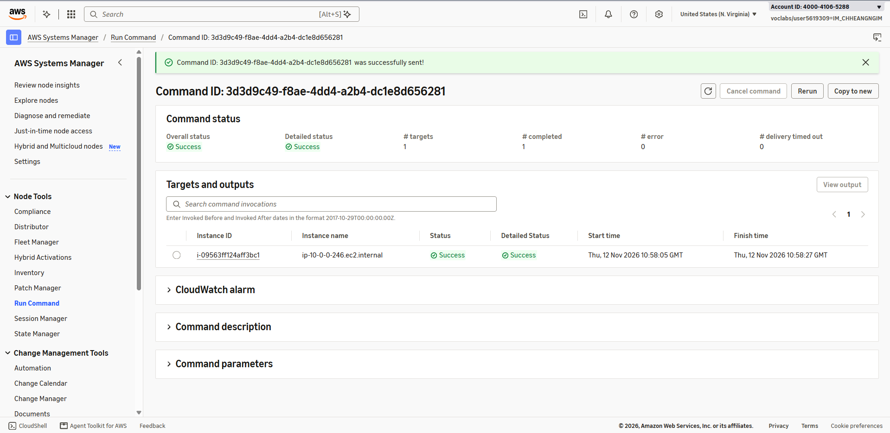

---

## Questions

1. The VPC is `10.0.0.0/24` and the subnets are `10.0.0.0/25` and `10.0.0.128/25`. How many IP addresses does each block contain, and why do the two subnets not overlap?
   - **VPC (`10.0.0.0/24`):** 256 total IP addresses (`10.0.0.0`–`10.0.0.255`).
   - **Subnet 1 (`10.0.0.0/25`):** 128 total IP addresses (`10.0.0.0`–`10.0.0.127`).
   - **Subnet 2 (`10.0.0.128/25`):** 128 total IP addresses (`10.0.0.128`–`10.0.0.255`).
   - **Why they do not overlap:** The 25th bit splits the `/24` block into two distinct ranges: `0` for IPs 0–127 and `1` for IPs 128–255.

2. Both subnets are in the same VPC. What exactly makes `lab4-public-subnet` public and `lab4-private-subnet` private?
   - Their **associated route tables**:
     - `lab4-public-subnet` has a default route (`0.0.0.0/0`) pointing directly to the **Internet Gateway (IGW)**.
     - `lab4-private-subnet` has a default route (`0.0.0.0/0`) pointing to the **NAT Gateway**, with no direct path to an IGW.

3. Why is the NAT gateway placed in the **public** subnet and not in the private one?
   - A NAT gateway requires a route to an Internet Gateway (`0.0.0.0/0 -> igw-xxxx`) and an Elastic IP to communicate with the internet. A private subnet does not have a route to an Internet Gateway.

4. `lab4-ec2-02` has no public IP address. Can someone on the internet open a connection to it? Can it download updates? Explain both answers.
   - **Open a connection to it? No.** It has no public IP, and the NAT gateway only allows outbound-initiated traffic while blocking unsolicited inbound connections.
   - **Download updates? Yes.** Outbound requests are routed through the NAT gateway, which translates the private IP to its public Elastic IP to fetch updates from the internet.

5. You tested internet access with Systems Manager instead of SSH. Why did the instances need `LabInstanceProfile` for this?
   - The SSM Agent inside the EC2 instance connects to AWS Systems Manager via outbound API calls. It requires the IAM permissions in `LabInstanceProfile` (such as `AmazonSSMManagedInstanceCore`) to authenticate and register with the SSM service.

## Problems and how I solved them (optional)

## AI note (optional)

## Clean up

- [x] Instances terminated.
- [x] NAT gateway deleted and its Elastic IP released.
- [x] Internet gateway detached and deleted.
- [x] `lab4-vpc` deleted.
